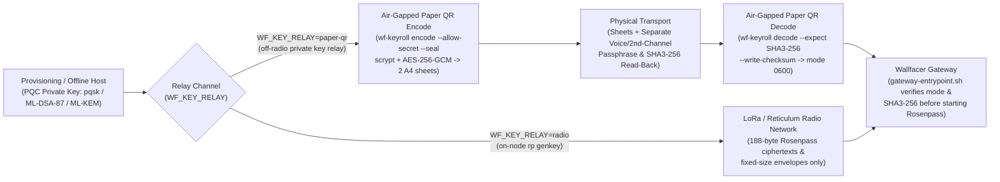

# ThereminQ PQC - Wallfacer Enclave Documentation

This directory contains the documentation and architectural blueprints for the Wallfacer enclave, a highly secure, post-quantum cryptographic execution environment.

## Overview

The Wallfacer architecture implements a zero-trust, quantum-resistant enclave designed to safeguard critical application execution, specifically focusing on Large Language Model (LLM) orchestration and autonomous agent workspaces. It enforces strict provenance, authentication, and execution policies.

## Architectural Layers

As detailed in the `wallfacer-architecture-flow.jpeg` schematic and `The_Wallfacer_Doctrine.pdf`, the system is structured into four primary defensive layers:

1. **Layer 1: Dark Perimeter (WireGuard & Rosenpass)**
   Establishes a quantum-resistant hybrid tunnel using Rosenpass for post-quantum key encapsulation alongside WireGuard. This layer ensures out-of-band key establishment (Classic McEliece / ML-KEM-768) and mutual attestation, protecting against "Harvest Now, Decrypt Later" (HNDL) attacks. When the LoRa / Reticulum radio network is unavailable, denied, or disallowed for private key material, nodes can relay PQC private keys and static keys physically via the **Out-of-Band Paper QR Key-Roll** (`wallfacer/keyroll` / `wallfacer_paper_keyroll.py`).

2. **Layer 2: Private PQC PKI**
   Utilizes OpenSSL 3.5 to implement a post-quantum Public Key Infrastructure. It relies on ML-KEM-768 for key encapsulation and ML-DSA-87 for digital signatures, managing certificate issuance and transitioned trust anchors. Offline signing and CA private keys can also be backed up or relayed between air-gapped hosts via passphrase-sealed (`scrypt` + `AES-256-GCM`) paper QR sheets and verified with `wf-ca fingerprint`.

3. **Layer 3: Artifact Provenance Guard**
   Enforces strict integrity checks on all executable artifacts, including container images and LLM weights (GGUF format). It verifies ML-DSA-87 signatures from the trusted, crypto-verified registry before allowing any component into the enclave.

4. **Layer 4: Semantic API Gatekeeper**
   Operates within the air-gapped internal application enclave. It scrutinizes all interactions with the LLM (e.g., a 70B parameter model) by applying semantic intent scoring, injection blocking, and zero cloud state leakage policies.

## Out-of-Band Key Relay Workflow (Radio vs. Paper QR Alternative)

## Key Concepts and Components

*   **Rosenpass**: A post-quantum secure key encapsulation mechanism used in conjunction with WireGuard to secure the outer perimeter against quantum adversaries.
*   **Paper QR Key-Roll (`wf-keyroll`)**: Air-gapped physical alternative to radio/IP transport for relaying PQC private keys (Classic McEliece `pqsk`, ML-DSA-87, ML-KEM-768/1024, SLH-DSA-SHA2-256s, PKCS#8 PEM), static public keys, and PSKs using `WFK1` Base45 QR frames with per-frame CRC32, SHA3-256 manifest verification, and optional `WFSEAL1` (`scrypt` + `AES-256-GCM`) passphrase sealing.
*   **ML-DSA-87**: The primary post-quantum digital signature algorithm used for code and model provenance.
*   **ML-KEM-768**: The key encapsulation mechanism for establishing secure communications within the PKI and perimeter layers.

## Relevant Academic Context

The underlying cryptographic and networking principles of the Wallfacer architecture are grounded in contemporary research in Post-Quantum Cryptography (PQC). For further reading on the related theoretical frameworks, consider the following academic publications:

*   **[PQC-Enhanced QKD Networks: A Layered Approach](https://arxiv.org/abs/2604.05599)**: Discusses layered approaches to quantum-safe networking which parallels our Layer 1 design.
*   **[Signature Placement in Post-Quantum TLS Certificate Hierarchies: An Experimental Study of ML-DSA and SLH-DSA in TLS 1.3 Authentication](https://arxiv.org/abs/2604.06100)**: Explores the practical deployment of ML-DSA signatures in certificate hierarchies, directly relevant to Layer 2.
*   **[Towards Post-Quantum Secure Pharmacovigilance with ML-KEM and ML-DSA](https://arxiv.org/abs/2606.09412)**: Provides context on integrating ML-KEM and ML-DSA for strict security and authentication.
*   **[From Public-Key Linting to Operational Post-Quantum X.509 Assurance for ML-KEM and ML-DSA: Registry-Driven Policy, Mutation-Based Evaluation, and Import Validation](https://arxiv.org/abs/2604.17003)**: Discusses ML-KEM and ML-DSA validation, relevant to our PKI and provenance layers.
